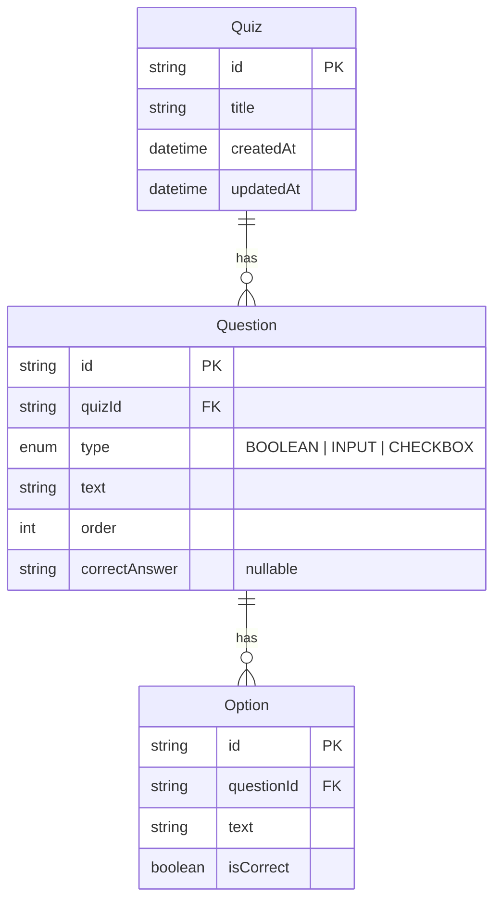

# Quiz Builder

Full-stack quiz creation app: **Express + TypeScript** API, **Next.js (React)** frontend, **PostgreSQL** via Docker, **Prisma**, and **Zod** validation.

## Prerequisites

- Node.js 18+
- npm
- Docker & Docker Compose

## Project structure

```
quiz-builder/
├── backend/          # Express API + Prisma
├── frontend/         # Next.js (React) UI
├── docker-compose.yml
└── README.md
```

## Data model

Source of truth: `backend/prisma/schema.prisma`.

- **BOOLEAN / INPUT** — correct value in `Question.correctAnswer`
- **CHECKBOX** — `correctAnswer` is null; answers live on `Option.isCorrect`
- Deleting a quiz cascades to its questions and options



## 1. Start the database

```bash
docker compose up -d
# or: npm run db:up
```

Postgres listens on `localhost:5432` (`quiz` / `quiz` / `quiz_builder`).

## 2. Backend

Stack: **Express**, **TypeScript**, **Prisma**, **PostgreSQL**, **Zod**. Env: `DATABASE_URL`, `PORT` (see `backend/.env.example`).

```bash
cd backend
cp .env.example .env
npm install
npx prisma migrate dev
npm run dev
```

API: [http://localhost:4000](http://localhost:4000)

### API

| Method   | Path           | Description                                      |
| -------- | -------------- | ------------------------------------------------ |
| `GET`    | `/health`      | Health check                                     |
| `GET`    | `/quizzes`     | List quizzes (id, title, question count)         |
| `GET`    | `/quizzes/:id` | Quiz detail with questions and options           |
| `POST`   | `/quizzes`     | Create quiz (Zod-validated body) → `201`         |
| `DELETE` | `/quizzes/:id` | Delete quiz (cascades questions/options) → `204` |

- Create body: title + questions (`BOOLEAN` / `INPUT` / `CHECKBOX`); checkbox options carry `isCorrect`
- Validation errors return structured Zod issues; missing quiz → `404`
- CORS allows `http://localhost:3000`

## 3. Frontend

Stack: **Next.js App Router**, **React Hook Form**, **Zod**, **Tailwind CSS**. Talks to the Express API via `NEXT_PUBLIC_API_URL` (see `frontend/.env.local.example`).

```bash
cd frontend
cp .env.local.example .env.local
npm install
npm run dev
```

App: [http://localhost:3000](http://localhost:3000)

Start the backend first so create / list / delete work against a live API.

## Pages

| Route           | Description                          |
| --------------- | ------------------------------------ |
| `/`             | Redirects to `/quizzes`              |
| `/create`       | Create a quiz with dynamic questions |
| `/quizzes`      | List quizzes (title, question count) |
| `/quizzes/[id]` | Quiz detail (read-only structure)    |

### Create form

- Title plus one or more questions (`BOOLEAN`, `INPUT`, `CHECKBOX`)
- Add / remove questions; checkbox questions support multiple options with correct flags
- Client validation with Zod (aligned with backend messages)
- On success, redirects to the quizzes list

### Quizzes list & detail

- List shows title and question count; delete removes a quiz via the API
- Delete opens a small confirmation modal (Cancel / Delete) before calling the API
- Detail shows question types, text, and answers / options (read-only)

### Mobile

- Sticky header with burger menu (desktop keeps inline nav links)
- Create form: **Remove question** shows as a centered **X** icon inside the same bordered button; full label from `md` up
- Layouts use responsive spacing; main content stays readable on small screens

## Sample quiz

With Postgres running and migrations applied, seed a sample quiz (BOOLEAN + INPUT + CHECKBOX):

```bash
cd backend
npm run seed
# or: npx prisma db seed
```

Or create quizzes from the **Create** page in the UI.

## Lint & format

From the repo root (after installing root deps with `npm install`):

```bash
npm run format
npm run lint
```

## Environment

- Backend: `backend/.env` (see `.env.example`) — never commit real `.env` files
- Frontend: `frontend/.env.local` (see `.env.local.example`)
