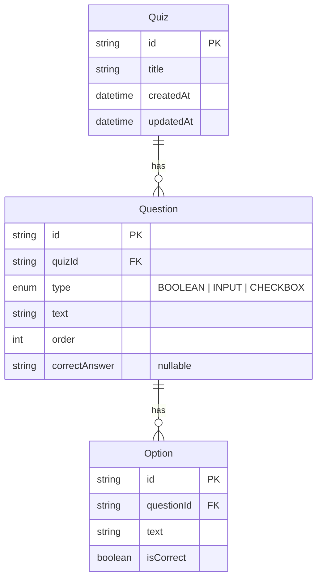

# Quiz Builder

Full-stack quiz creation app: **Express + TypeScript** API, **Next.js (React)** frontend, **PostgreSQL** via Docker, **Prisma**, and **Zod** validation.

## Prerequisites

- Node.js 18+
- npm
- Docker & Docker Compose

## Project structure

```
quiz-builder/
├── backend/          # Express API + Prisma
├── frontend/         # Next.js (React) UI
├── docker-compose.yml
└── README.md
```

## Data model

Source of truth: `backend/prisma/schema.prisma`.

- **BOOLEAN / INPUT** — correct value in `Question.correctAnswer`
- **CHECKBOX** — `correctAnswer` is null; answers live on `Option.isCorrect`
- Deleting a quiz cascades to its questions and options



## 1. Start the database

```bash
docker compose up -d
# or: npm run db:up
```

Postgres listens on `localhost:5432` (`quiz` / `quiz` / `quiz_builder`).

## 2. Backend

```bash
cd backend
cp .env.example .env
npm install
npx prisma migrate dev
npm run dev
```

API: [http://localhost:4000](http://localhost:4000)

## 3. Frontend

```bash
cd frontend
cp .env.local.example .env.local
npm install
npm run dev
```

App: [http://localhost:3000](http://localhost:3000)

## Pages

| Route           | Description                          |
| --------------- | ------------------------------------ |
| `/create`       | Create a quiz with dynamic questions |
| `/quizzes`      | List quizzes (title, question count) |
| `/quizzes/[id]` | Quiz detail (read-only structure)    |

## Sample quiz

After the API is running, create a quiz via **Create** in the UI, or (once implemented) run:

```bash
cd backend && npm run seed
```

## Lint & format

From the repo root (after installing root deps with `npm install`):

```bash
npm run format
npm run lint
```

## Environment

- Backend: `backend/.env` (see `.env.example`) — never commit real `.env` files
- Frontend: `frontend/.env.local` (see `.env.local.example`)
